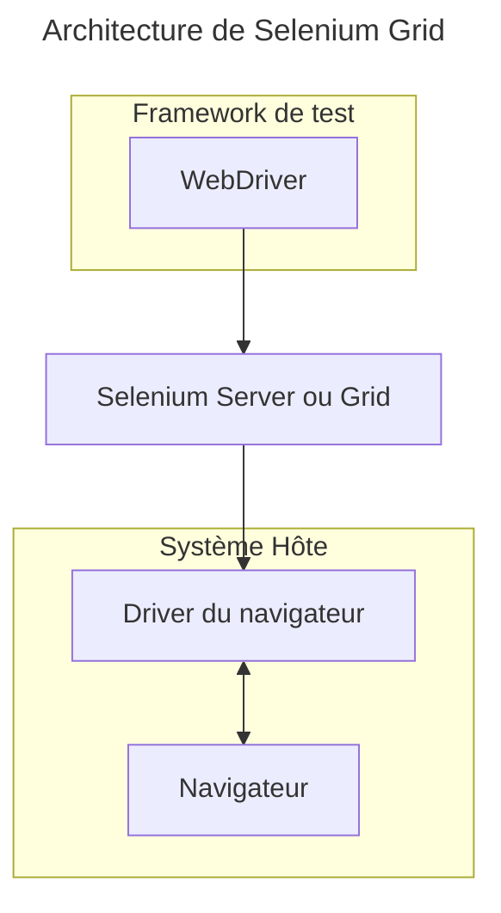

## Présentation

- Outil d'automatisation des actions utilisateur dans un navigateur web et de récupérer les résultats de ces actions :
  - visiter une page
  - cliquer sur un lien
  - remplir un formulaire, etc.

---

## Composants

---

### Selenium IDE

> Enregistrer, éditer et débugger les tests

- Manière la plus simple de créer des scripts `Selenium`.
- Enregistre via un plugin pour `Firefox` / `Chrome` les actions de l'utilisateur pendant la navigation sur le site et les affiche dans une interface.
- Permet de réaliser rapidement des scripts en mode enregistrement/rejeu.

---

- Les scripts sont ensuite exportables en langages de plus haut niveau : `Java`, `Python`, ... mais demanderont d'être retravaillés pour assurer une maintenabilité dans le temps.
- Peu d'intérêt pour construire un framework d'automatisation mais pratique pour démarrer sur `Selenium` ou faire des scripts rapides pour reproduction des bug.

---


<div class="caption">Le plugin Selenium IDE</div>

---

### WebDriver

> Écriture des tests automatisés

- Les API de `Selenium` : permettent en écrivant du code de test d'automatiser le navigateur et les vérifications associées.
- `Selenium WebDriver` est la nouvelle implémentation de `Selenium` et est souvent choisi pour les nouveaux projets.
- Disponible dans les langages `Ruby`, `Java`, `Python`, `C#,` `C# NuGet` et `EcmaScript` et supporte tous les navigateurs classiques.

---

```python
class TestSearch(unittest.TestCase):

    def setUp(self):
        self.driver = webdriver.Firefox()

    def test_results_page_shows(self):
        self.driver.get("https://en.wikipedia.org/wiki/Main_Page")
        input = self.driver.find_element(By.ID, "searchInput")
        input.send_keys("Selenium")
        input.send_keys(Keys.RETURN)

        page_url = self.driver.current_url

        self.assertEqual(page_url, "https://en.wikipedia.org/wiki/Main_Page")

    def tearDown(self):
        self.driver.close()
```

---

### Selenium Grid

> Accélération des tests fonctionnels

- Exécute des scripts `WebDriver` sur des machines distantes physiques ou virtuelles.
- Permettre l'exécution de tests en parrallèle sur des machines dédiées ayant la puissance nécessaire à l'exécution de tests d'interface graphique
- Peut utiliser des matrices d'environnements hétérogènes pour les tests : Windows / Linux, Firefox / Chrome

---



<div class="caption">Selenium Grid : Framework de tests avec WebDriver, Selenium Serveur ou Grid, Navigateur avec driver Sélénium lié au navigateur.</div>

## Quelques bonnes pratiques

- Utiliser des sélecteurs CSS (pas de XPath), notamment :
  - `By.ID` (le plus robuste)
  - `By.CSS_SELECTOR` (flexible)
- De nombreux frameworks frontend génèrent du code (et donc des attributs `CSS`) à chaque exécution du code, il est donc très risqué d'utiliser des attributs internes au framework !
- On essaiera donc d'utiliser au maximum des attributs `CSS` ajoutés manuellement dans le code. De même, pour éviter tout soucis de duplication, on utilisera plutôt des `classes` `CSS` que des `ID`.

---

## Exemples de tests Selenium

---

### Vérifier un titre simple

```html
<!DOCTYPE html>
<html>
<head>
    <title>Test Page</title>
</head>
<body>
    <h1 id="main-title">Bienvenue</h1>
</body>
</html>
```

```python
from selenium import webdriver
from selenium.webdriver.common.by import By

driver = webdriver.Chrome()
driver.get("https://…")

title = driver.find_element(By.ID, "main-title")
assert title.text == "Bienvenue"

driver.quit()
```

👉 Vérifie :

- présence de l'élément
- contenu texte exact

---

### Vérifier un formulaire

```html
<!DOCTYPE html>
<html>
<body>
    <form>
        <input type="text" id="username" value="admin">
        <button id="submit-btn">Envoyer</button>
    </form>
</body>
</html>
```

```python
from selenium import webdriver
from selenium.webdriver.common.by import By

driver = webdriver.Chrome()
driver.get("https://…")

input_field = driver.find_element(By.ID, "username")
button = driver.find_element(By.ID, "submit-btn")

assert input_field.get_attribute("value") == "admin"
assert button.is_displayed()

driver.quit()
```

👉 Vérifie :

- valeur d'un attribut
- visibilité d'un élément

---

### Vérifier une liste dynamique

```html
<!DOCTYPE html>
<html>
<body>
    <ul id="items">
        <li class="item">Item 1</li>
        <li class="item">Item 2</li>
        <li class="item">Item 3</li>
    </ul>
</body>
</html>
```

```python
from selenium import webdriver
from selenium.webdriver.common.by import By

driver = webdriver.Chrome()
driver.get("https://…")

items = driver.find_elements(By.CLASS_NAME, "item")

assert len(items) == 3
assert items[0].text == "Item 1"

driver.quit()
```

👉 Vérifie :

- nombre d'éléments
- ordre dans le DOM

---

### Vérifier un changement après interaction

```html
<!DOCTYPE html>
<html>
<body>
    <button onclick="document.getElementById('msg').innerText='OK'">
        Cliquer
    </button>
    <p id="msg"></p>
</body>
</html>
```

```python
from selenium import webdriver
from selenium.webdriver.common.by import By

driver = webdriver.Chrome()
driver.get("https://…")

button = driver.find_element(By.TAG_NAME, "button")
button.click()

msg = driver.find_element(By.ID, "msg")
assert msg.text == "OK"

driver.quit()
```

👉 Vérifie :

- interaction utilisateur
- mutation du DOM

---

### Vérifier une classe CSS conditionnelle

```html
<!DOCTYPE html>
<html>
<body>
    <div id="status" class="inactive"></div>
</body>
</html>
```

```python
from selenium import webdriver
from selenium.webdriver.common.by import By

driver = webdriver.Chrome()
driver.get("https://…")

status = driver.find_element(By.ID, "status")

classes = status.get_attribute("class")
assert "inactive" in classes

driver.quit()
```

👉 Vérifie :

- état via classes CSS (très courant en frontend moderne)

---

### Wait explicite

Exemple avancé : ajouter des **waits explicites** pour vérifier une condition dans le DOM de manière dynamique (dans le cas où le changement du DOM est lent, par exemple pour attendre l'apparition d'un élément avec un `ID` donné dans une grosse application) :

```python
from selenium.webdriver.support.ui import WebDriverWait
from selenium.webdriver.support import expected_conditions as EC

WebDriverWait(driver, 10).until(
    EC.presence_of_element_located((By.ID, "msg"))
)
```

---

### PageObject

- Un code de test `Sélénium` est très proche de l'implémentation de la page Web, ce qui rend sa lecture très compliquée. Le pattern architectural `PageObject`, `PageElement` (parfois aussi appelé `HTMLWrapper`) permet de grandement améliorer l'architecture des tests :
- On décrit dans une classe dédiée les éléments de la page à tester et on abstrait les interactions de l'utilisateur dans des méthodes dédiées.
- Puis on utilise cette abstraction pour décrire le test.

---

Exemple de test utilisant les `PageObject` `LoginPage` et `HomePage` encapsulant les données et comportements des pages `/home` et `/login` :

```java
 public void testLogin() {

        LoginPage loginPage = new LoginPage(this.getWebDriver());
        HomePage homePage = new HomePage(this.getWebDriver());

        loginPage.setUsername("administrator");
        loginPage.setPassword("password");
        loginPage.submit();

        if(homePage.isDisplayed()){
          this.setPassed();
        }

        this.setFailed();
   }
```

---

## Ressources

- [Extraits de code pour la manipulation des navigateurs](https://www.selenium.dev/documentation/en/webdriver/browser_manipulation/)
- [Localisation d'éléments (sélecteurs `CSS`)](https://www.selenium.dev/documentation/en/webdriver/locating_elements/)
- [Pattern PageObject](https://www.ingenieurtest.fr/2019/11/selenium-le-design-pattern-page-object.html)
- [Testing Library avec Selenium](https://github.com/anze3db/selenium-testing-library)
- Lien sélecteurs CSS :
  - <https://www.guru99.com/locators-in-selenium-ide.html>
  - <https://saucelabs.com/resources/blog/selenium-tips-css-selectors>
- [Guildelines Selenium](https://www.selenium.dev/documentation/test_practices/)
- Voir aussi :
  - [Playright, une alternative à Selenium avec support de Mocks et tracing des tests](https://playwright.dev/)
  - [Cypress](https://www.cypress.io/)

---

## Legal

- Oracle and Java are registered trademarks of Oracle and/or its affiliates.
- Linux is a registered trademark of Linus Torvalds.
- "Python" is a registered trademark of the PSF. The Python logos (in several variants) are use trademarks of the PSF as well. ®
- Windows is a registered trademark of Microsoft Corporation in the United States and other countries.
- Other names may be trademarks of their respective owners
